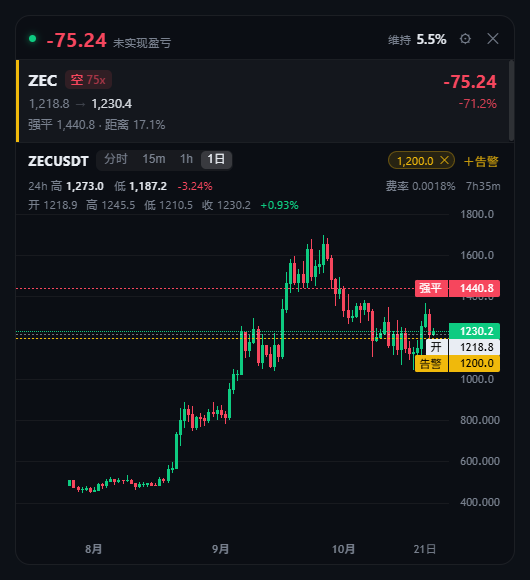
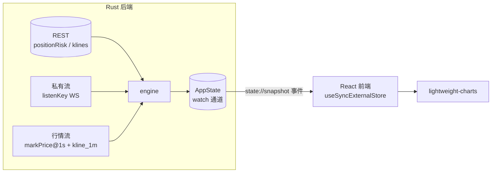

# binance-mini

<p align="center">
  
</p>

<p align="center">
  
  
  
  
  
  
</p>

<p align="center">
  常驻桌面角落的币安 USDT-M 永续合约盯盘小窗. 抬眼两秒看到浮亏、离强平多远、有没有触及自己设的线.
</p>

> 只用只读 API Key, 不下单, 不碰任何写接口.

---

## ✨ 功能

| | 能力 | 说明 |
| --- | --- | --- |
| 📊 | **持仓面板** | 交易对、方向、杠杆、开仓价、标记价、未实现盈亏 (金额 + 百分比)、强平距离 |
| ↔️ | **双向持仓** | 按 `positionSide` 拆行, 同一合约的 LONG / SHORT 分开渲染, 盈亏不串 |
| 📉 | **迷你 K 线** | 分时 / 15m / 1h / 1d, 滚轮缩放、拖动平移, 图上画开仓价、强平价、止盈止损、告警线 |
| 🛡️ | **风险信息** | 保证金率、强平距离百分比、资金费率、下次结算倒计时 |
| 🔔 | **价格线告警** | 穿越判定 (持续在一侧不算) + 5 分钟冷却, 触发时 Windows 通知 + 提示音 |
| 🩺 | **连接健康度** | 私有流与行情流分开监测, 断线指数退避重连, 15 秒无数据整块标灰 |
| 🖥️ | **托盘与热键** | 托盘显示 / 隐藏、切换置顶、退出; 全局 `Ctrl+Alt+B` 显隐 |
| 🧊 | **单实例** | 重复启动只聚焦已有窗口, 不会开出第二个进程吃掉双倍内存 |
| 🎚️ | **窗口记忆** | 位置、尺寸、不透明度 (30%–100%)、开机自启全部持久化 |
| 🔐 | **密钥安全** | API Key / Secret 存 Windows 凭据管理器, 不落明文配置文件 |

## 📦 安装

从 [Releases](https://github.com/ThornClub/binance-mini/releases) 下载:

| 文件 | 说明 |
| --- | --- |
| `BinanceMini_0.1.0_x64-setup.exe` | 安装包, 用户级安装, **不需要管理员权限** |
| `binance-mini.exe` | 免安装, 直接双击运行 |

首次启动会弹出引导页填写 API Key / Secret. Key 只需要 **读取权限**, 不要开交易和提现权限.

## 🚀 使用

| 操作 | 效果 |
| --- | --- |
| 拖动窗口任意空白处 | 移动位置, 松手自动记住 |
| `Ctrl+Alt+B` | 全局显示 / 隐藏 |
| 点持仓行 | 切换下方 K 线对应的合约 |
| 滚轮 / 拖动图表 | 缩放 / 平移 K 线 |
| `分时` `15m` `1h` `1日` | 切换周期 |
| `＋告警` | 在当前合约上添加价格线 |
| ⚙ | 置顶、不透明度、开机自启、权限自检、清除密钥 |
| ✕ | 收进托盘 (不是退出) |

## 🛠️ 开发

前置环境:

| 组件 | 版本 |
| --- | --- |
| Node.js | 20.19+ 或 22.12+ |
| Rust | stable, edition 2024 (需要 1.85+) |
| Visual Studio Build Tools | 2022, 含 MSVC 与 Windows SDK |
| WebView2 Runtime | Win10/11 通常已自带 |

```bash
npm install
npm run tauri dev      # 开发模式, 前端热更新, Rust 改动自动重启
npm run tauri build    # 出安装包
```

产物:

```
src-tauri/target/release/binance-mini.exe
src-tauri/target/release/bundle/nsis/BinanceMini_0.1.0_x64-setup.exe
```

质量门 (提交前跑):

```bash
npx tsc --noEmit
cd src-tauri && cargo clippy -- -D warnings && cargo test
```

## 🤖 自动发布

推 `v*` 标签会触发 GitHub Actions, 在 `windows-latest` 上编译并创建 release, 自动挂上安装包和免安装 exe:

```bash
git tag v0.1.0
git push origin v0.1.0
```

也可以在 Actions 页面手动 `Run workflow`, 只编译并上传 artifact, 不发 release.

> 仓库需要开启写权限: Settings → Actions → General → Workflow permissions 选 **Read and write permissions**, 否则创建 release 会报 `Resource not accessible by integration`.

## 🏗️ 架构



- 签名、签名时间校准、WebSocket 续期与重连全在 Rust 侧, 前端拿不到密钥
- 轮询频率跟随状态自适应: 有仓位且可见 1s / 隐藏 30s / 无仓位 60s, 权重超过 2000 自动翻倍间隔
- 强平价只能从 REST `positionRisk` 拿到, 所以必须轮询; 其余数据优先走推送

## 🔒 安全边界

- 只使用 GET 接口, 代码里没有任何下单、撤单、改杠杆的调用
- 密钥存 Windows 凭据管理器 (`keyring`), 进程退出时 `zeroize` 擦除内存
- 日志只打印 Key 前 4 位
- 本项目不收集、不上传任何数据, 所有请求直接从本机发往 `fapi.binance.com` / `fstream.binance.com`

## ⚠️ 免责

个人自用工具. 行情来自币安公开 API, 显示延迟、断线重连、限流都可能让数字暂时不准. 任何交易决策请以币安官方客户端为准.
