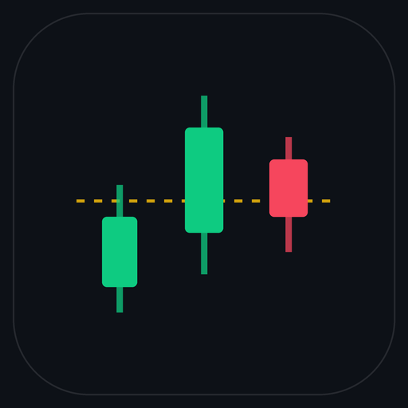
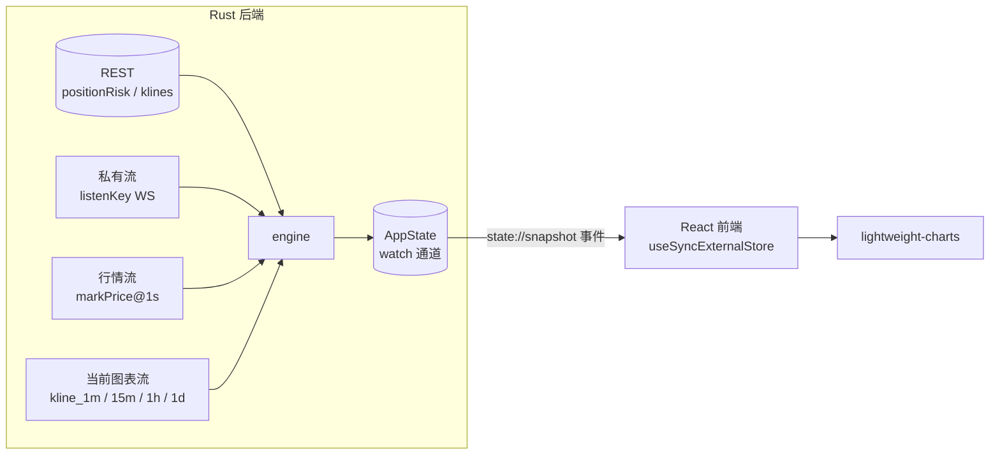

# binance-mini

<p align="center">
  
</p>

<p align="center">
  
  
  
  
  
  
</p>

<p align="center">
  常驻桌面角落的币安 USDT-M 永续合约盯盘小窗. 抬眼两秒看到浮亏、离强平多远、有没有触及自己设的线.
</p>

> 使用只读 API Key, 不下单、不撤单、不改杠杆. 私有数据流使用 POST/PUT 管理 listenKey, 不是交易接口.

---

## ✨ 功能

| | 能力 | 说明 |
| --- | --- | --- |
| 📊 | **持仓面板** | 交易对、方向、杠杆、开仓价、标记价、未实现盈亏 (金额 + 百分比)、强平距离 |
| ↔️ | **双向持仓** | 按 `positionSide` 拆行, 同一合约的 LONG / SHORT 分开渲染, 盈亏不串 |
| 📉 | **迷你 K 线** | 分时 (1m) / 15m / 1h / 1d 均接收当前合约对应周期的实时 K 线; 滚轮缩放、拖动平移, 图上画开仓价、强平价、止盈止损、告警线 |
| 🛡️ | **风险信息** | 保证金率、强平距离百分比、资金费率、下次结算倒计时 |
| 🔔 | **价格线告警** | 穿越判定 (持续在一侧不算) + 5 分钟冷却, 触发时 Windows 通知 + 提示音 |
| 🚨 | **强平距离告警** | 距强平跌破阈值 (默认 10%, 可调) 就通知 + 响声; 迟滞 2% + 3 分钟冷却, 价格贴着阈值不会反复弹 |
| 🩺 | **连接健康度** | 连接与数据新鲜度分开, 持仓风险、账户、各合约行情、图表独立计时; 过期或恢复失败明确提示, 不以一个连接正常代表全部数据有效 |
| 🖥️ | **托盘与热键** | 托盘显示 / 隐藏、切换置顶、退出; 全局 `Ctrl+Alt+B` 显隐 |
| 🧊 | **单实例** | 重复启动只聚焦已有窗口, 不会开出第二个进程吃掉双倍内存 |
| 🎚️ | **窗口记忆** | 位置、尺寸、不透明度 (30%–100%)、开机自启全部持久化 |
| 🔐 | **密钥安全** | API Key / Secret 存 Windows 凭据管理器, 不落明文配置文件 |

## 📦 安装

从 [Releases](https://github.com/ThornClub/binance-mini/releases) 下载:

| 文件 | 说明 |
| --- | --- |
| `BinanceMini_0.3.0_x64-setup.exe` | 安装包, 用户级安装, **不需要管理员权限** |
| `binance-mini.exe` | 免安装, 直接双击运行 |

首次启动会弹出引导页填写 API Key / Secret. 确认 **已启用读取、未启用交易、未启用提现**. 建议配置可信出口 IP 白名单, 不要求关闭白名单. 接口自检只证明本次持仓读取成功, 不能完整审计 Key 的交易、提现等权限; 请在交易所侧核查. 读取被拒绝时先核查 Key、出口 IP、合约账户状态和读取权限, 不要为排错开启交易或提现权限.

## 🚀 使用

| 操作 | 效果 |
| --- | --- |
| 拖动窗口任意空白处 | 移动位置, 松手自动记住 |
| `Ctrl+Alt+B` | 全局显示 / 隐藏 |
| 点持仓行 | 切换下方 K 线对应的合约 |
| 滚轮 / 拖动图表 | 缩放 / 平移 K 线 |
| `分时` `15m` `1h` `1日` | 切换周期 |
| `＋告警` | 在当前合约上添加价格线 |
| ⚙ | 置顶、不透明度、强平告警阈值、全部价格告警管理、开机自启、权限自检、清除密钥 |
| ✕ | 收进托盘 (不是退出) |

切换合约或周期会清空旧图并加载历史, 期间缓存实时 K 线. 重连握手成功后重新补齐当前窗口历史 (1m/15m/1h/1d 分别为 180/120/120/90 根), 按开盘时间、成交笔数和终结态合并, 不用标记价伪造 OHLC. 历史恢复失败会保留失效提示并提供重试, 收到一条实时消息不代表缺口已补齐. 健康连接不再每 20 秒全量刷新历史.

数据新鲜度依据各来源最后成功时间与刷新预算分别判断, 即使没有新快照也会更新过期提示. 风险数据预算覆盖正常隐藏/空仓轮询间隔, 不是固定 15 秒无消息就判全部失效; 私有流无交易事件也不等于连接失效. 回到前台会立即尝试刷新, 但仍遵守限流冷却.

## 🛠️ 开发

前置环境:

| 组件 | 版本 |
| --- | --- |
| Node.js | 20.19+ 或 22.12+ |
| Rust | 当前 stable, edition 2024 |
| Visual Studio Build Tools | 2022, 含 MSVC 与 Windows SDK |
| WebView2 Runtime | Win10/11 通常已自带 |

```powershell
$ErrorActionPreference = 'Stop'
npm ci
npm run tauri dev      # 开发模式, 前端热更新, Rust 改动自动重启
npm run tauri build    # 出安装包
```

产物:

```
src-tauri/target/release/binance-mini.exe
src-tauri/target/release/bundle/nsis/BinanceMini_0.2.0_x64-setup.exe
```

质量门 (在仓库根目录逐项运行, 任一失败则停止):

```powershell
$ErrorActionPreference = 'Stop'
npm ci
if ($LASTEXITCODE -ne 0) { throw '依赖安装失败' }
npm test
if ($LASTEXITCODE -ne 0) { throw '前端测试失败' }
npx --no-install tsc --noEmit
if ($LASTEXITCODE -ne 0) { throw '类型检查失败' }
npm run build
if ($LASTEXITCODE -ne 0) { throw '前端构建失败' }
node tests/session-bridge.mjs
if ($LASTEXITCODE -ne 0) { throw '桥接自检失败' }
cargo test --locked --manifest-path src-tauri/Cargo.toml -j 1
if ($LASTEXITCODE -ne 0) { throw 'Rust 测试失败' }
cargo clippy --locked --manifest-path src-tauri/Cargo.toml -j 1 -- -D warnings
if ($LASTEXITCODE -ne 0) { throw 'Rust clippy 失败' }
```

测试使用模拟 IPC、DOM 与本地网络替身, 不读取真实凭据或访问真实账户. 本地检查不能代替真实 WebView2 通知、GUI、真实账户或远程 CI 验证.

## 🤖 自动发布

`.github/workflows/release.yml` 配置 PR、master 推送、`v*` 标签推送和手动运行共享质量门禁: 锁定依赖安装、前端测试、类型检查、前端构建、桥接自检、Rust test/clippy. PR 只运行只读权限的检查, 不打包、不发布. 门禁失败阻止后续打包发布.

master 推送和 Actions 页面手动 `Run workflow` 在门禁通过后编译并上传 artifact, 不发 release (手动选择标签也不发布). 推送 `v*` 标签在门禁通过后才创建 release, 自动挂上安装包和免安装 exe. 不需要为了本地验证推送标签.

> 工作流默认 `contents: read`, 仅非 PR 的打包发布 job 请求 `contents: write`. 仓库或组织策略须允许发布 job 写入 release. 工作流文件的本地静态检查不代表 GitHub Actions 已通过, 实际结果以对应 Actions run 为准.

## 🏗️ 架构



- 签名、签名时间校准、WebSocket 续期与重连全在 Rust 侧. 运行时接口和快照不向前端回传已存 Secret; 首次录入时前端输入框和组件状态会暂持 Key/Secret, 保存成功后清空
- 轮询频率跟随状态自适应: 有仓位且可见 1s / 隐藏 30s / 无仓位 60s, 权重超过 2000 自动翻倍间隔
- 强平价只能从 REST `positionRisk` 拿到, 所以必须轮询; 其余数据优先走推送

## 🔒 安全边界

- 持仓、账户、订单与行情查询使用 GET; 私有数据流通过 `POST /fapi/v1/listenKey` 创建 listenKey、`PUT /fapi/v1/listenKey` 续期, 到期或断开后重建. 这些是流生命周期调用, 不是下单、撤单、改杠杆或提现接口
- 密钥存 Windows 凭据管理器 (`keyring`), 不写入明文配置. Rust 的 `Creds` 释放时用 `zeroize` 清理其 Secret 字符串; 不宣称可擦除前端/系统中的所有副本. 初次录入仍须信任本机和前端运行环境
- 网络错误移除 URL, 不回显 Secret、签名 URL、listenKey 或服务端原始认证错误正文; 凭据调试输出只保留 Key 前 4 位
- 只读使用约定不等于自动审计 Key 全部权限. 始终在交易所侧确认未开启交易、提现并维护 IP 白名单; 读取成功不能证明其他权限关闭
- 本项目无遥测上传; 币安业务请求从本机发往 `fapi.binance.com` / `fstream.binance.com`, 认证请求会按接口要求携带 API Key 或签名, Secret 用于本地签名

## ⚠️ 免责

个人自用工具. 行情来自币安公开 API, 显示延迟、断线重连、限流都可能让数字暂时不准. 任何交易决策请以币安官方客户端为准.
